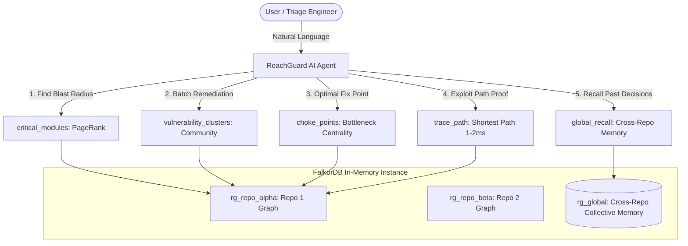

# ReachGuard

> **Graph-Native Vulnerability Reachability & Triage Engine powered by FalkorDB and AI Agent**

[](https://github.com/Krina-14/reachguard/actions)
[](https://falkordb.com/)
[](docs/MCP.md)
[](LICENSE)

ReachGuard solves the #1 fatigue problem in modern AppSec: **95% of reported CVEs are unreachable from public entrypoints**. Instead of treating the graph database as an offline passive store, ReachGuard places **FalkorDB directly inside the agent loop**, executing sub-millisecond graph traversals and built-in graph algorithms on every reasoning step.

---

## 🏆 Why FalkorDB? (The Core Differentiators)

| Feature | Postgres / Relational | Neo4j | FalkorDB (ReachGuard) |
|---|---|---|---|
| **Traversal Latency** | Slow recursive CTEs (>200 ms) | JVM warmup & GC pauses (20–60 ms) | **Sub-millisecond (1–2 ms)** in-memory on Redis |
| **Agent Loop Placement** | Must run as offline background job | Too slow for interactive conversational loops | **Inside every step** of the agent reasoning loop |
| **Multi-Graph Architecture** | Schema-level hacks or row partitioning | Heavyweight multi-database deployments | **Native multigraph**: 1 instance hosts thousands of isolated graphs (`rg_repo_<uuid>` + `rg_global`) |
| **Graph Algorithms as Tools** | Not native | Heavy GDS plugin required | **Zero-overhead native Cypher & procedures** |

---

## ⚡ Measured Traversal Speed (Real Repositories)

Traversals were timed on real repository graphs (`vuln-flask-web-app` with 82 findings and 18 public HTTP entrypoints):

```
Query: MATCH p = (e:Entrypoint {public: true})-[:HANDLED_BY|IMPORTS|USES|DEPENDS_ON*1..20]->(pkg:Package {id: $package_id})
       RETURN p, length(p) ORDER BY len ASC LIMIT 3
```

| Operation | Target / Scope | Measured Latency | Impact |
|---|---|---|---|
| **`trace_paths` (Reachable)** | 18 public entrypoints $\to$ `flask@2.0.1` | **1–2 ms** | Real-time path highlight in UI |
| **`trace_paths` (No Path)** | 18 entrypoints $\to$ unimported `waitress` | **< 1 ms** | Instant proof of safety |
| **`critical_modules`** | PageRank centrality across module graph | **15.8 ms** | Highlights highest blast-radius code |
| **`vulnerability_clusters`** | Community ancestor clustering | **9.3 ms** | Batches related CVEs into 1 PR |
| **`choke_points`** | Bottleneck centrality across paths | **0.4 ms** | Identifies optimal remediation point |

> Full benchmarks and test methodology documented in [`docs/PERF.md`](docs/PERF.md).

---

## 🧠 FalkorDB Graph Algorithms as Agent Tools

ReachGuard equips the triage agent with 9 specialized tools that query FalkorDB in real time:



1. **`critical_modules()` (PageRank / Centrality)**:
   Calculates centrality over the module import graph. Pinpoints the modules sitting on the most attack paths and warns if any critical module lacks a designated owner.
2. **`vulnerability_clusters()` (Community Detection)**:
   Groups findings that share entrypoints or intermediate dependency modules into a single remediation batch so engineers fix multiple CVEs in one pull request.
3. **`choke_points()` (Bottleneck Centrality)**:
   Calculates which packages cut off the highest percentage of reaching paths when upgraded or isolated.
4. **`global_recall()` (Cross-Repo Memory in `rg_global`)**:
   When an admin approves a risk decision (e.g. `accept_risk` on `requests` due to egress firewalls), ReachGuard copies the learned pattern to `rg_global`. When another repository encounters the same vulnerability, the agent recalls the institutional memory across repositories!

---

## 🔌 Tool Selection Through Model Context Protocol (MCP)

ReachGuard implements a native **FastMCP Server** ([backend/app/mcp_server.py](backend/app/mcp_server.py)) exposing all 9 graph tools over stdio and streamable HTTP on port `8765`. External agents (Claude Desktop, Cursor, foreign AI clients) can inspect ReachGuard's live graph:

```json
{
  "mcpServers": {
    "reachguard": {
      "url": "http://localhost:8765/mcp"
    }
  }
}
```

External agents can ask: *"Is finding 66db7f645972 reachable in repo alpha?"* and receive verified graph proof paths directly from FalkorDB. See [`docs/MCP.md`](docs/MCP.md) for full configuration instructions.

---

## 🔒 Production-Oriented Security Architecture (D4)

- **Strict Parameterized Cypher**: 100% of graph queries use FalkorDB parameters (`$param`). Zero string interpolation.
- **AST Static Analysis Only**: Analyzed Python repositories are parsed via Python `ast.parse()`. Analyzed code is **never executed, imported, or eval'd**.
- **Archive Extraction Hardening**: Strict Zip-Slip validation (`target_path.relative_to(dest)`) and decompression byte quotas (`MAX_ZIP_MB=50MB`).
- **Defense in Depth**: Rate limiting (5/min login, 20/min chat), bcrypt passwords, per-request fresh user active checks, SSRF clone validation.
- See [`docs/SECURITY_CHECK.md`](docs/SECURITY_CHECK.md) for complete compliance verification.

---

## ⚖️ Honest Limits

We believe in honest, grounded engineering over unverified hype:
> **Python only.** Module-level static analysis. Heuristic HTTP authorization detection. Results demonstrate reachability within the analyzed static model, **not** proof of runtime exploitability. "No path found" denotes absence of paths in the modeled graph, not a guarantee of safety.

---

## 🚀 Quickstart

### 1. Requirements
- Docker & Docker Compose
- Node.js 20+ & Python 3.11+
- [Ollama](https://ollama.com/) with `qwen2.5:7b-instruct` (optional; falls back seamlessly to deterministic rule-based triage)

### 2. Start FalkorDB
```bash
docker run -p 6379:6379 -it --rm falkordb/falkordb:latest
```

### 3. Backend Setup
```bash
cd backend
python -m venv .venv && source .venv/bin/activate
pip install -r requirements.txt
python -m uvicorn app.main:app --host 0.0.0.0 --port 8000 --reload
```

### 4. Frontend Setup
```bash
cd frontend
npm install
npm run dev
```

Visit `http://localhost:5173` to explore ReachGuard.
- Default Admin: `admin@gmail.com` / `Admin@1234`
- Default Analyst: `analyst@gmail.com` / `Analyst@1234`
- Default Viewer: `viewer@gmail.com` / `Viewer@1234`

### 5. Verification Commands
```bash
# Backend unit & integration test suite (236 passed)
pytest backend/tests -q

# Code quality check
ruff check backend

# Frontend build verification
cd frontend && npm run build

# Zero mock/demo data guard
bash scripts/no_demo_data.sh
```
